<p align="center">
  <picture>
    <source media="(prefers-color-scheme: dark)" srcset="docs/readme/banner.dark.png">
    
  </picture>
</p>

<p align="center">
  По данным закупки система возвращает десять компаний, и у каждой есть основание: закупка, дата
  и ссылка на источник. Решение остаётся за заказчиком.
</p>

<p align="center">
  <!-- readme:buttons -->
  <a href="#запуск"><picture><source media="(prefers-color-scheme: dark)" srcset="docs/readme/cta-run.dark.png"></picture></a>
  <br>
  <a href="docs/ml/README.md"><picture><source media="(prefers-color-scheme: dark)" srcset="docs/readme/cta-quality.dark.png"></picture></a>
  <a href="docs/README.md"><picture><source media="(prefers-color-scheme: dark)" srcset="docs/readme/cta-docs.dark.png">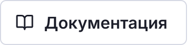</picture></a>
  <!-- /readme:buttons -->
</p>

<p align="center">
  <!-- readme:status -->
  <a href="#результаты"><picture><source media="(prefers-color-scheme: dark)" srcset="docs/readme/badge-status-1.dark.png">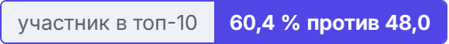</picture></a>
  <a href="#результаты"><picture><source media="(prefers-color-scheme: dark)" srcset="docs/readme/badge-status-2.dark.png">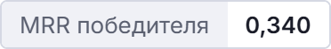</picture></a>
  <br>
  <a href="#результаты"><picture><source media="(prefers-color-scheme: dark)" srcset="docs/readme/badge-status-3.dark.png">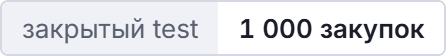</picture></a>
  <a href="LICENSE"><picture><source media="(prefers-color-scheme: dark)" srcset="docs/readme/badge-status-4.dark.png"></picture></a>
  <!-- /readme:status -->
</p>

<p align="center">
  <!-- readme:stack -->
  <picture><source media="(prefers-color-scheme: dark)" srcset="docs/readme/badge-stack-1.dark.png">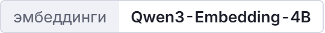</picture>
  <picture><source media="(prefers-color-scheme: dark)" srcset="docs/readme/badge-stack-2.dark.png"></picture>
  <br>
  <picture><source media="(prefers-color-scheme: dark)" srcset="docs/readme/badge-stack-3.dark.png">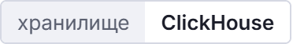</picture>
  <picture><source media="(prefers-color-scheme: dark)" srcset="docs/readme/badge-stack-4.dark.png">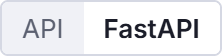</picture>
  <picture><source media="(prefers-color-scheme: dark)" srcset="docs/readme/badge-stack-5.dark.png">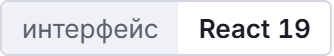</picture>
  <!-- /readme:stack -->
</p>

<p align="center">
  <!-- readme:nav -->
  <a href="#зачем-это"><picture><source media="(prefers-color-scheme: dark)" srcset="docs/readme/badge-nav-1.dark.png">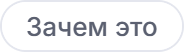</picture></a>
  <a href="#как-это-работает"><picture><source media="(prefers-color-scheme: dark)" srcset="docs/readme/badge-nav-2.dark.png">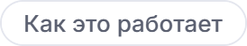</picture></a>
  <a href="#попробовать-за-две-минуты"><picture><source media="(prefers-color-scheme: dark)" srcset="docs/readme/badge-nav-3.dark.png">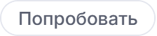</picture></a>
  <br>
  <a href="#результаты"><picture><source media="(prefers-color-scheme: dark)" srcset="docs/readme/badge-nav-4.dark.png"></picture></a>
  <a href="#запуск"><picture><source media="(prefers-color-scheme: dark)" srcset="docs/readme/badge-nav-5.dark.png">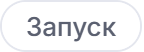</picture></a>
  <a href="#устройство"><picture><source media="(prefers-color-scheme: dark)" srcset="docs/readme/badge-nav-6.dark.png">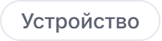</picture></a>
  <a href="#ограничения"><picture><source media="(prefers-color-scheme: dark)" srcset="docs/readme/badge-nav-7.dark.png"></picture></a>
  <!-- /readme:nav -->
</p>

<p align="center">
  
</p>

## Зачем это

Контрактный управляющий получает закупку, и ему нужно понять, кого позвать, а потом письменно
обосновать выбор. Поиск по названию здесь не помогает:

- в реестре МСП 6,77 млн компаний, вручную их не перебрать;
- 16 004 из 44 199 поставщиков архива встречаются в нём всего один раз, статистику по ним не построить;
- в архиве АИС ГЗ видны победы, но нет цен предложений и оценок исполнения.

Поэтому lotive не выдаёт один балл. Он строит короткий список и рядом с каждой компанией
показывает, на чём держится рекомендация: прошлые закупки в той же категории, их даты и ссылки,
регион из реестра МСП, предложения из открытых каталогов.

## Как это работает

Сервис состоит из двух контуров. API рекомендаций отвечает на запрос заказчика за секунды,
а фоновые воркеры независимо от него пополняют каталог.

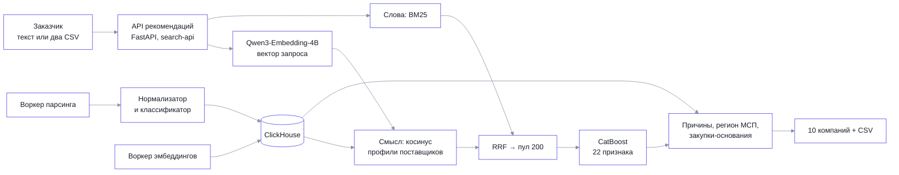

- **Смысл и точные слова вместе.** Кандидатов ищут два канала: векторы Qwen3-Embedding-4B и
  BM25. Списки сливаются через RRF, затем CatBoost ранжирует пул из 200 по 22 признакам истории
  закупок. Гибрид находит больше участников, чем каждый канал отдельно.
- **Основание рядом с утверждением.** Вклад признаков превращается в понятные причины:
  релевантность, опыт, категория, заказчик, давность, цена. К каждой компании прикладываются до
  пяти закупок-оснований с датой и ссылкой.
- **Пул шире архива.** Фоновый воркер обходит открытые каталоги, приводит карточки к одной
  форме, присваивает код ОКПД2 с указанием канала и его уверенности и складывает всё в
  ClickHouse. Без основания код не ставится.

<p align="center">
  
</p>

## Попробовать за две минуты

| Шаг | Что сделать | Что увидите |
|---|---|---|
| 1 | Запустите сервис по разделу [Запуск](#запуск) и откройте <http://localhost:8080> | Поле поиска и историю запросов |
| 2 | Опишите, что нужно, например «перчатки хирургические латексные» | Десять компаний с ролью, регионом и статусом |
| 3 | Выберите компанию | Почему она в списке: причины, число закупок и побед, закупки-основания со ссылками |
| 4 | Загрузите извещения и потоварку двумя CSV | Список по каждой закупке, склеенный по `lot_id` |
| 5 | Нажмите «Скачать CSV» | Файл, который можно приложить к обоснованию выбора |

## Результаты

Качество проверено на закрытом test: 1 000 закупок 2025 года, история только до 01.06.2025,
test открыт один раз после фиксации модели. Метка — реальные участники и победитель закупки.

| Показатель | Поиск | + CatBoost |
|---|---:|---:|
| Известный участник в топ-10 | 48,0 % | **60,4 %** |
| Победитель в топ-10 | 40,7 % | **52,3 %** |
| MRR победителя | 0,275 | **0,340** |

Прирост MRR +0,065, 95 % доверительный интервал +0,048…+0,082. Полнота поиска участников на
validation (Recall@100): 0,531 у BM25 и 0,610 у гибрида с Qwen3-Embedding-4B. Каждая цифра,
её команда и выборка — в [журнале экспериментов](docs/ml/experiments.md).

<p align="center">
  
</p>

## Запуск

```bash
cp .env.example .env
git lfs pull
docker compose up -d --build
docker compose run --rm sync-job sync
```

Фронтенд откроется на <http://localhost:8080>, API — на <http://localhost:8000/api>. Исходные
данные организаторов лежат в `task/data/` в Git LFS. Переменные окружения, миграции и проверки
описаны в [запуске и проверках](docs/running.md).

## Устройство

| Раздел | Что внутри |
|---|---|
| [Backend](docs/backend.md) | Слои, джоба сбора, адаптеры источников, ClickHouse, [HTTP API и коды ошибок](docs/backend.md#http-api) |
| [Фоновые воркеры](docs/workers.md) | Парсер, эмбеддер, воркер векторизации |
| [Нормализатор и классификатор](docs/normalization-and-classification.md) | Как карточка приводится к одной форме и откуда берётся код ОКПД2 |
| [ML и качество](docs/ml/README.md) | Подготовка данных, поиск, ранжирование, метрики |
| [Контракт API](docs/api-contracts.md) | Примеры запросов и ответов из [`contracts/`](contracts) |
| [Задание организаторов](task/docs/presentation.md) | Исходное ТЗ и [ML-спецификация](task/ML_SPEC.md) |
| [Оглавление](docs/README.md) | Все страницы документации |

## Ограничения

- **Метка качества неполная.** Участник закупки в истории не единственная подходящая компания,
  поэтому реальная польза списка выше измеренной.
- **История и каталоги пока идут двумя каналами.** Кандидаты из каталогов получают статус
  проверки; единое ранжирование — следующий шаг.
- **Замеры скорости сделаны на синтетике.** Миллион реальных предложений не проверялся.

## Лицензия

[MIT](LICENSE)
